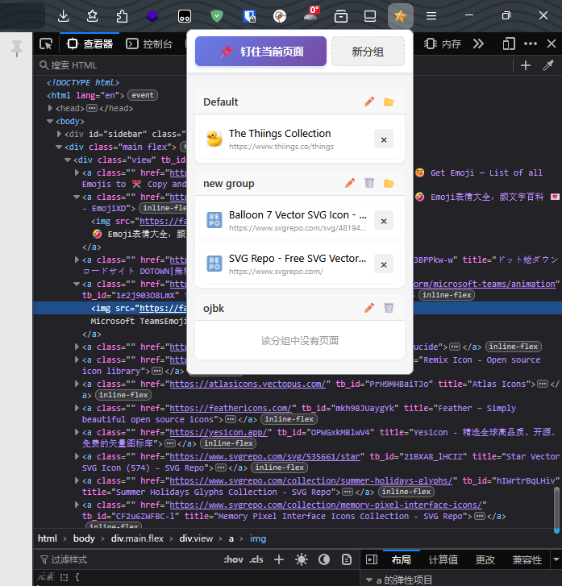

# Tmpin 浏览器扩展

[English Version](./README_EN.md)

## 项目介绍
Tmpin 是一款专为 Firefox 浏览器设计的轻量级扩展，帮助用户快速访问和管理常用网页。通过简单直观的界面，用户可以轻松钉住、分组和管理常用链接，提高浏览效率。

## 核心功能

### 🔖 页面钉住
- 一键钉住当前页面到默认分组
- 支持通过右键菜单钉住页面
- 自动同步页面标题和图标

### 📁 分组管理
- 支持创建多个自定义分组
- 拖拽排序功能，可在分组内和分组间拖拽链接
- 分组展开/折叠功能
- 分组重命名和删除功能
- 点击分组中的"全部打开"按钮，可在新标签页中打开所有链接

### 🌐 多语言支持
- 支持中文和英文界面切换
- 基于浏览器语言自动适配

### 📱 数据同步
- 使用浏览器内置的同步功能，实现跨设备数据同步
- 无需额外账号，安全可靠

### 🎨 现代界面
- 简洁美观的现代设计
- 流畅的动画效果
- 响应式布局，适配不同屏幕尺寸

## 截图展示



## 使用的服务
- **图标服务**：[Thiings Collection](https://www.thiings.co/things)
- **AI 开发工具**：Trae CN

## 开发说明

### 项目结构
```
tmpin/
├── _locales/           # 多语言文件
│   ├── en/             # 英文翻译
│   └── zh_CN/          # 中文翻译
├── icons/              # 扩展图标
├── background.js       # 后台脚本
├── manifest.json       # 扩展配置文件
├── popup.html          # 弹出窗口 HTML
├── popup.css           # 弹出窗口样式
└── popup.js            # 弹出窗口逻辑
```

### 技术栈
- 原生 JavaScript
- HTML5
- CSS3
- Firefox 扩展 API
